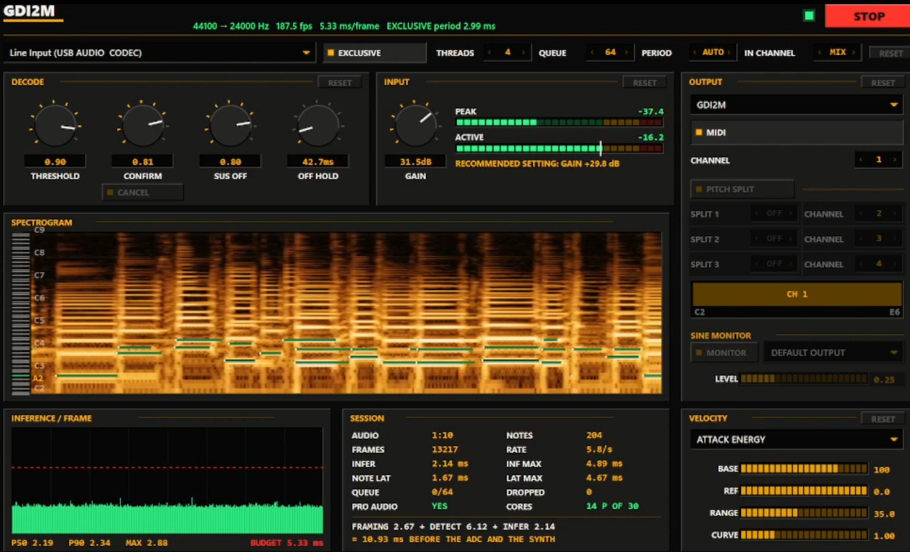

# Real-time guitar DI to MIDI



A custom causal architecture that translates the full guitar range polyphonically, one output frame per 5.33 ms at 24 kHz, with ~9 ms delay. The repo contains all PyTorch training scripts and an inference app with WASAPI capture and MIDI out.

### Installation (Windows only):
- Download `gdi2m_ui.exe` from the [Releases](../../releases) page. It is one file: the model, the ONNX Runtime and the C runtime are all inside it.
- Install [loopMIDI](https://www.tobias-erichsen.de/software/loopmidi.html) and create a port.
- Run the exe, pick the capture device and the loopMIDI port, click start. MIDI events will be streamed to the port, so your DAW sees it as it would any MIDI keyboard.

### Build it yourself (alternative):

MSVC + CMake + Ninja. `cl` does not need to be on PATH; the script imports vcvars64 itself.

```powershell
powershell -File tools\gdi2m\build.ps1                        # dev build, links the ORT DLL
powershell -File tools\gdi2m\build.ps1 -Static <ort-release>  # what ships, static ORT + static CRT
```

The static build wants an ONNX Runtime built from source (no prebuilt static release exists anywhere); the exact configure command is in the header of `build.ps1`. Export a graph first with `python export/export_onnx.py`, which writes `export/gdi2m.onnx` plus its sidecars. The static build embeds those as resources, so the resulting exe carries its own model. `-NoEmbed` loads them from `export/` instead, which is what you want while iterating.

### Model architecture

24 kHz audio, note events out, ~2.6 M parameters, 9.5 MB.
Two causal STFTs share one hop and one constant-Q grid: a 2048 window for pitch resolution on the low strings and a 512 window for onset timing. Features are fed into a causal 2D CNN with cross-band interaction. A single GRU shared between all pitch rows behind a learned gate at the end.
Instead of predicting per-string pitch, we predict onset and sustain over 53 pitch rows, which allows for very aggressive data augmentation.

### Data
Three datasets feed into one window composer: GOAT, GuitarSet and Guitar-TECHS. 545 recordings, ~10 hours, 180 855 notes, with diverse augmentation techniques.

### License

MIT - see [LICENSE](LICENSE).
